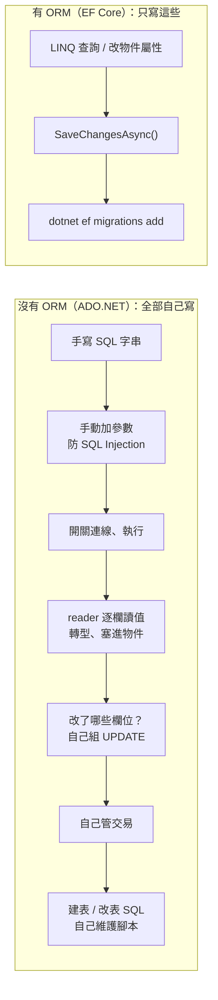
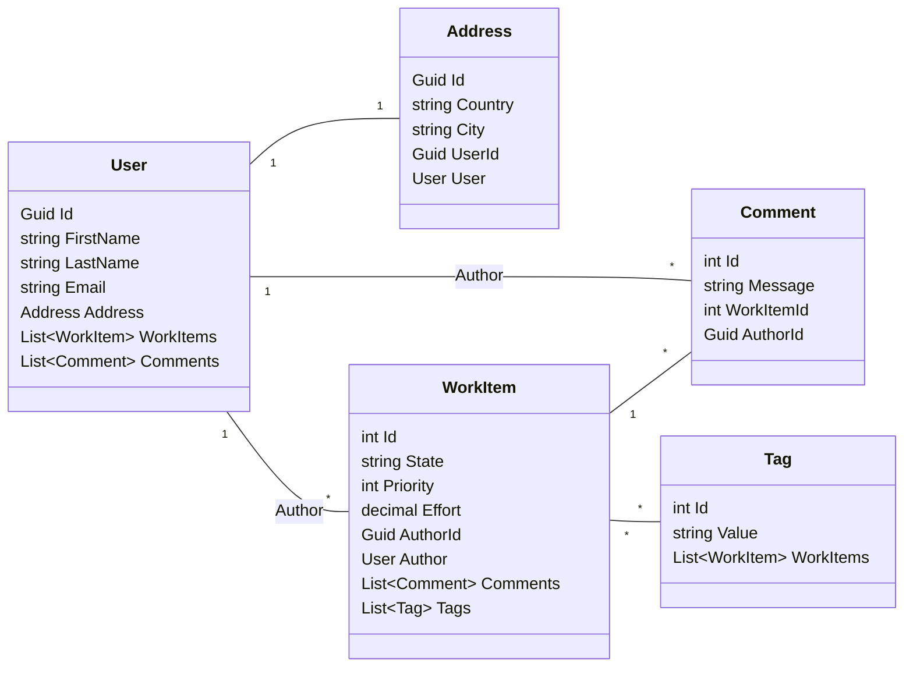
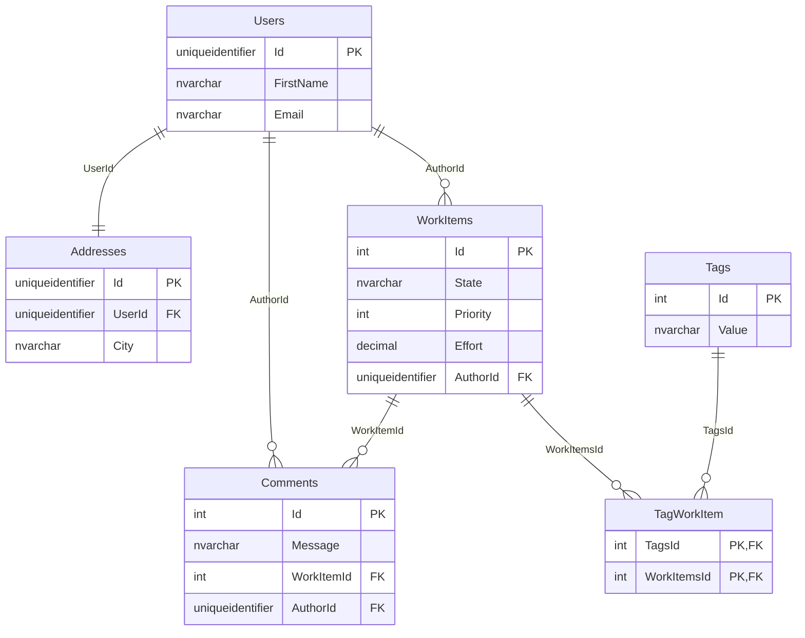
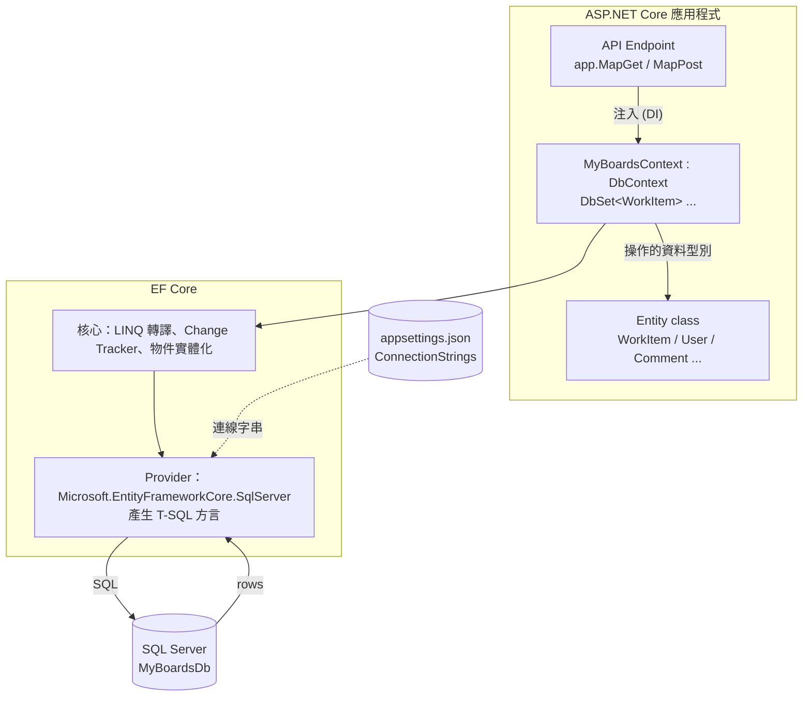
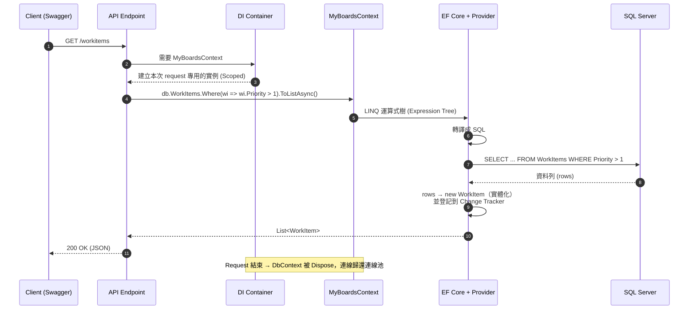
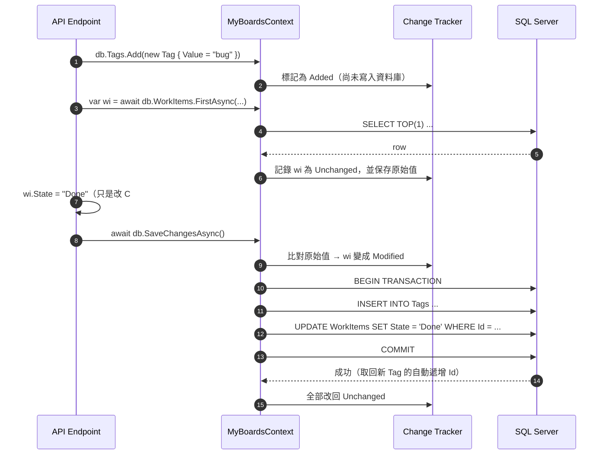
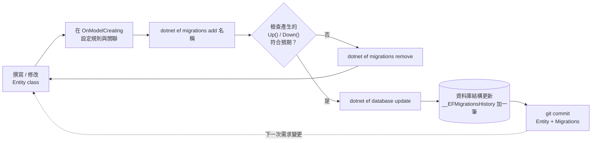

# EF Core 入門：ORM 原理與連接資料庫（Code First）

- 標籤：#ef-core #orm #database #sql-server #migration
- 最後更新：2026-10-17

## 重點摘要

- ORM（EF Core）負責「物件 ↔ 資料列」「LINQ ↔ SQL」的翻譯，class 是資料的藍圖
- 流程：**Entity class → DbContext → 註冊 DI + 連線字串 → Migration 建表 → 注入 DbContext 使用**
- 需要：`Microsoft.EntityFrameworkCore.SqlServer`、`Microsoft.EntityFrameworkCore.Design`（版本對齊 .NET 6 → `6.0.x`）、`dotnet-ef` 工具
- 每個 Entity 都要有**主鍵**（屬性叫 `Id` 會自動被當主鍵）
- 關聯用「導覽屬性 + 外鍵」表達；欄位規則與關聯集中寫在 `OnModelCreating`（Fluent API）
- 改了 Entity 就要 `dotnet ef migrations add <名稱>` → `dotnet ef database update`

---

## 1. 原理

> 本文的圖用 [Mermaid](https://mermaid.js.org/) 撰寫：GitHub 會直接渲染；Rider 需在
> `Settings → Languages & Frameworks → Markdown` 勾選 **Mermaid** 後，在 Markdown 預覽中顯示。
> 也可直接用瀏覽器開啟 HTML 版：`docs/html/notes/ef-core/connect-database.html`（執行 `docs/_tools/build-html.ps1` 產生）。

### 1.1 為什麼要有 class？

程式和資料庫是**兩個不同的世界**：

| | C# 程式（物件世界） | 資料庫（關聯世界） |
|---|---|---|
| 資料單位 | 物件 `WorkItem` | 一列 row |
| 結構 | class 的屬性 | table 的欄位 |
| 關聯 | 物件參考：`workItem.Comments` | 外鍵：`Comments.WorkItemId` |
| 操作 | 呼叫方法、LINQ | SQL 字串 |

兩邊的表達方式不一樣（稱為 *Object-Relational Impedance Mismatch*），所以需要一個「翻譯層」。**class 就是程式這一端用來描述「資料長什麼樣子」的藍圖**。

#### 沒有 class 會怎樣？（ADO.NET 直接寫 SQL）

```csharp
using var conn = new SqlConnection(connectionString);
conn.Open();
var cmd = new SqlCommand("SELECT Id, State, Priority FROM WorkItems WHERE Priority > @p", conn);
cmd.Parameters.AddWithValue("@p", 1);
using var reader = cmd.ExecuteReader();
while (reader.Read())
{
    var state = (string)reader["Staet"];    // 打錯字：編譯會過，執行才爆炸
    var priority = (int)reader["Priority"]; // 型別轉錯也要執行才知道
}
```

#### 有 class + EF Core

```csharp
var items = await db.WorkItems
    .Where(wi => wi.Priority > 1)   // 打錯屬性名 → 編譯錯誤，IDE 直接標紅
    .ToListAsync();                 // 拿到的就是 List<WorkItem>，型別確定
```

#### class 的目的整理

| 目的 | 說明 |
|------|------|
| **描述資料結構** | 屬性 = 欄位，型別 = 欄位型別（`int`→`int`、`string`→`nvarchar`、`DateTime?`→可為 NULL 的 `datetime2`） |
| **型別安全** | 編譯器幫你檢查欄位名稱與型別，IntelliSense 自動完成 |
| **Code First 的「設計圖」** | EF Core 讀 class 推導出資料表結構，Migration 依此建表 |
| **用物件表達關聯** | `workItem.Author.Email` 比手寫 JOIN 直覺 |
| **承載資料在各層之間流動** | 查詢結果變成物件，可以再處理、序列化成 JSON 回傳給前端 |
| **與資料庫解耦** | 換資料庫（SQL Server → PostgreSQL）時，class 和 LINQ 幾乎不用改，只換 Provider |

> 這種「只有屬性、對應到資料表」的 class 稱為 **Entity**（實體），也常被叫做 POCO（Plain Old CLR Object）——它不需要繼承任何 EF 的類別，就是普通的 class。

### 1.2 為什麼要用 ORM？

**ORM（Object-Relational Mapper，物件關聯對映）** 就是 1.1 提到的「翻譯層」：自動把 **物件 ↔ 資料列**、**LINQ ↔ SQL** 互相轉換。EF Core 是 .NET 官方的 ORM。

#### 沒有 ORM 時，這些事都要自己做



| 工作 | 沒有 ORM | EF Core 自動處理 |
|------|---------|------------------|
| 寫 SQL | 每個查詢手寫字串 | LINQ 轉譯 |
| 資料列 → 物件 | `reader["欄位"]` 逐一轉型 | 自動實體化（Materialization） |
| 防 SQL Injection | 自己記得參數化 | 預設參數化 |
| 產生 UPDATE | 自己判斷改了哪些欄位 | Change Tracker 比對 |
| 交易 | 手動 `BeginTransaction` | 一次 `SaveChanges` 就是一個交易 |
| 資料表結構 | 手寫 DDL、手動同步 | Migration 依 class 產生、有版本紀錄 |
| 換資料庫 | SQL 方言不同要改寫 | 換 Provider |

#### .NET 常見的三種資料存取方式

| | ADO.NET | Dapper（Micro-ORM） | EF Core（完整 ORM） |
|---|---|---|---|
| SQL 誰寫 | 自己 | 自己 | 自動產生（也可自己寫） |
| 結果 → 物件 | 手動 | 自動 | 自動 |
| 變更追蹤 / 自動 UPDATE | ✗ | ✗ | ✓ |
| Migration | ✗ | ✗ | ✓ |
| 關聯（導覽屬性、Include） | ✗ | 手動 multi-mapping | ✓ |
| 執行效能 | 最快 | 接近 ADO.NET | 稍慢（多一層轉譯與追蹤） |
| 開發速度 | 慢 | 中 | 快 |
| 適合 | 極致效能、底層工具 | 複雜報表、手調 SQL | 一般 CRUD、商業邏輯為主的應用 |

#### ORM 的代價（要知道的坑）

- **效能開銷**：多一層 LINQ 轉譯與 Change Tracking。純讀取可用 `AsNoTracking()` 減少負擔。
- **產生的 SQL 不一定最佳**：例如 **N+1 問題**——迴圈裡存取導覽屬性，導致每筆各發一次查詢；要用 `Include` 一次載入。
- **抽象會漏**：還是要懂 SQL，才看得懂 EF 產生了什麼。開發時可在 `appsettings.Development.json` 把 `Microsoft.EntityFrameworkCore.Database.Command` 的 LogLevel 設為 `Information` 來看實際 SQL。
- **不是全有全無**：EF Core 也能執行自寫 SQL（`FromSqlInterpolated`、`ExecuteSqlInterpolatedAsync`），也可以同一專案混用 Dapper 處理特別的查詢。

#### 本專案為什麼選 EF Core

MyBoards 是以 CRUD 和實體關聯（User / WorkItem / Comment / Tag）為主的 Web API，正好是 ORM 最擅長的情境：用 class 描述模型、Migration 管 schema 版本、LINQ 寫查詢，開發速度與可維護性最好；之後真的遇到效能瓶頸，再針對該查詢改用自寫 SQL 或 Dapper。

### 1.3 class 如何對應到資料表

左邊是 C# class（含導覽屬性），右邊是 Migration 產生出來的資料表：





重點觀察：

- **導覽屬性（`Author`、`Comments`、`Tags`）不會變成欄位**，它們只存在於 C# 端；資料庫裡只看得到外鍵欄位。
- **多對多**在 C# 是兩邊各放一個 `List`，在資料庫則多出一張中間表 `TagWorkItem`（EF Core 自動建立）。

### 1.4 整體架構：誰負責什麼



### 1.5 一次查詢在背後發生什麼（時序圖）

以 `GET /workitems` 查詢 Priority > 1 的 WorkItem 為例：



> `Where(...)` 本身不會查資料庫，只是在組裝查詢；直到 `ToListAsync()`、`FirstAsync()` 等「取值」方法才真的送出 SQL（**延遲執行 Deferred Execution**）。

### 1.6 一次寫入在背後發生什麼（時序圖）

DbContext 會「記住」你對物件做了什麼（Change Tracking），`SaveChanges` 時才一次寫入：



Entity 在 Change Tracker 中的狀態：

| 狀態 | 何時出現 | SaveChanges 時 |
|------|---------|---------------|
| `Added` | `Add()` | `INSERT` |
| `Unchanged` | 剛查詢出來 / 剛存檔 | 不做事 |
| `Modified` | 改了屬性值 | `UPDATE`（只更新有改的欄位） |
| `Deleted` | `Remove()` | `DELETE` |
| `Detached` | 不受追蹤 | 不做事 |

### 1.7 Code First 開發流程（流程圖）



### 1.8 名詞對照

| 觀念 | 角色 | 對應資料庫 |
|------|------|-----------|
| **Entity**（一般 class） | 資料的形狀 | 一張 Table，屬性 = 欄位 |
| **`DbContext`** | 一次工作階段（Unit of Work）：追蹤變更，`SaveChanges()` 時一次寫入 | 整個資料庫 |
| **`DbSet<T>`** | Context 上的屬性，查詢 / 新增的入口 | 一張 Table |
| **Connection String** | 資料庫位置、帳密，放在 `appsettings.json` | 連線資訊 |
| **DI 註冊**（`AddDbContext`） | ASP.NET Core 每個 HTTP request 給你一個新的 DbContext（Scoped） | — |
| **Migration** | 比對 C# 模型差異，產生建表 / 改表的程式碼 | Schema 版本控制 |

> **Code First**：以 C# 程式碼為準，資料庫結構由 Migration 產生。相對的是 Database First（先有資料庫，再用 `dotnet ef dbcontext scaffold` 反向產生 class）。

---

## 2. 準備工作

### 2.1 安裝 NuGet 套件

在 `MyBoards/`（`.csproj` 所在資料夾）執行：

```bash
dotnet add package Microsoft.EntityFrameworkCore.SqlServer --version 6.0.*
dotnet add package Microsoft.EntityFrameworkCore.Design --version 6.0.*
```

| 套件 | 用途 |
|------|------|
| `Microsoft.EntityFrameworkCore.SqlServer` | EF Core 本體 + SQL Server Provider（會自動帶入 `Microsoft.EntityFrameworkCore`） |
| `Microsoft.EntityFrameworkCore.Design` | 讓 `dotnet ef` 指令能讀取專案、產生 Migration（只在設計階段用） |

> 為什麼鎖 6.0.x：EF Core 7 以上雖然有些版本仍支援 net6.0，但 8+ 就需要 .NET 8。跟 runtime 同一大版號最不容易出問題。

### 2.2 安裝 `dotnet-ef` 工具

```bash
dotnet tool install --global dotnet-ef --version 6.*
dotnet ef --version     # 確認安裝成功
```

已經裝過其他版本：`dotnet tool update --global dotnet-ef --version 6.*`

### 2.3 準備資料庫

| 選項 | 適合 | 連線字串範例 |
|------|------|-------------|
| **SQL Server LocalDB**（推薦，Windows） | 本機開發，免設定 | `Server=(localdb)\\mssqllocaldb;Database=MyBoardsDb;Trusted_Connection=True;` |
| SQL Server（Docker） | 跨平台、接近正式環境 | `Server=localhost,1433;Database=MyBoardsDb;User Id=sa;Password=<密碼>;TrustServerCertificate=True;` |
| SQLite | 最輕量，一個檔案 | `Data Source=myboards.db`（改用 `Microsoft.EntityFrameworkCore.Sqlite` + `UseSqlite`） |

確認 LocalDB 有沒有裝：

```bash
sqllocaldb info          # 列出執行個體，應看到 MSSQLLocalDB
```

沒有的話：安裝 [SQL Server Express](https://www.microsoft.com/sql-server/sql-server-downloads) 時勾選 LocalDB。

---

## 3. 修改 Entity：加主鍵與關聯

### 3.1 本專案的關聯設計

```
User 1 ── 1 Address        使用者有一個地址
User 1 ── * WorkItem       使用者建立多個 WorkItem（Author）
User 1 ── * Comment        使用者寫多則留言（Author）
WorkItem 1 ── * Comment    一個 WorkItem 有多則留言
WorkItem * ── * Tag        多對多
```

### 3.2 關聯怎麼表達

- **導覽屬性（Navigation Property）**：指向另一個 Entity 的屬性，例如 `public User Author { get; set; }`
- **外鍵（Foreign Key）**：存在「多」的那一方或「附屬」的那一方，例如 `public Guid AuthorId { get; set; }`
- **集合導覽**：「一」的那一方用 `List<T>`，例如 `public List<Comment> Comments { get; set; } = new();`
- **多對多**：兩邊都放集合就好，EF Core 5+ 會自動建立中間表（`TagWorkItem`）

### 3.3 主鍵型別

- 一般用 `int`：EF Core 預設自動遞增（`IDENTITY`）
- `User` 用 `Guid`：ID 會出現在 URL / API 時不容易被猜到，也方便分散式系統產生

### 3.4 修改後的 Entity

```csharp
// Entities/User.cs
public class User
{
    public Guid Id { get; set; }
    public string FirstName { get; set; }
    public string LastName { get; set; }
    public string Email { get; set; }

    public Address Address { get; set; }                         // 1:1
    public List<WorkItem> WorkItems { get; set; } = new();       // 1:*
    public List<Comment> Comments { get; set; } = new();         // 1:*
}
```

```csharp
// Entities/Address.cs
public class Address
{
    public Guid Id { get; set; }
    public string Country { get; set; }
    public string City { get; set; }
    public string Street { get; set; }
    public string PostCode { get; set; }

    public User User { get; set; }
    public Guid UserId { get; set; }      // 外鍵放在附屬方（Address 依附 User）
}
```

```csharp
// Entities/WorkItem.cs
public class WorkItem
{
    public int Id { get; set; }
    public string State { get; set; }
    public string Area { get; set; }
    public string IterationPath { get; set; }
    public int Priority { get; set; }

    //Epic
    public DateTime? StartDate { get; set; }
    public DateTime? EndDate { get; set; }

    //Issue
    public decimal Effort { get; set; }

    //Task
    public string Activity { get; set; }
    public decimal RemainingWork { get; set; }

    public List<Comment> Comments { get; set; } = new();   // 1:*
    public User Author { get; set; }                       // *:1
    public Guid AuthorId { get; set; }
    public List<Tag> Tags { get; set; } = new();           // *:*
}
```

```csharp
// Entities/Comment.cs
public class Comment
{
    public int Id { get; set; }
    public string Message { get; set; }
    public DateTime CreateDate { get; set; }
    public DateTime? UpdateDate { get; set; }

    public WorkItem WorkItem { get; set; }
    public int WorkItemId { get; set; }

    public User Author { get; set; }      // 取代原本的 string Author
    public Guid AuthorId { get; set; }
}
```

```csharp
// Entities/Tag.cs
public class Tag
{
    public int Id { get; set; }
    public string Value { get; set; }

    public List<WorkItem> WorkItems { get; set; } = new();  // *:*
}
```

> 慣例（Convention）：屬性名稱 `<導覽屬性名>Id`（如 `AuthorId`）且型別跟對方主鍵相同，EF Core 會自動認成外鍵。

---

## 4. 建立 DbContext

```csharp
// Entities/MyBoardsContext.cs
using Microsoft.EntityFrameworkCore;

namespace MyBoards.Entities;

public class MyBoardsContext : DbContext
{
    public MyBoardsContext(DbContextOptions<MyBoardsContext> options) : base(options)
    {
    }

    public DbSet<WorkItem> WorkItems { get; set; }
    public DbSet<User> Users { get; set; }
    public DbSet<Tag> Tags { get; set; }
    public DbSet<Comment> Comments { get; set; }
    public DbSet<Address> Addresses { get; set; }

    protected override void OnModelCreating(ModelBuilder modelBuilder)
    {
        modelBuilder.Entity<WorkItem>(eb =>
        {
            eb.Property(wi => wi.State).IsRequired();
            eb.Property(wi => wi.Area).HasColumnType("varchar(200)");
            eb.Property(wi => wi.IterationPath).HasColumnName("Iteration_Path");
            eb.Property(wi => wi.Effort).HasPrecision(14, 2);
            eb.Property(wi => wi.RemainingWork).HasPrecision(14, 2);
            eb.Property(wi => wi.EndDate).HasPrecision(3);
            eb.Property(wi => wi.Activity).HasMaxLength(200);
            eb.Property(wi => wi.Priority).HasDefaultValue(1);

            eb.HasMany(wi => wi.Comments)
              .WithOne(c => c.WorkItem)
              .HasForeignKey(c => c.WorkItemId);

            eb.HasOne(wi => wi.Author)
              .WithMany(u => u.WorkItems)
              .HasForeignKey(wi => wi.AuthorId);

            eb.HasMany(wi => wi.Tags)
              .WithMany(t => t.WorkItems);
        });

        modelBuilder.Entity<Comment>(eb =>
        {
            eb.Property(c => c.CreateDate).HasDefaultValueSql("getutcdate()");
            // 注意：ValueGeneratedOnUpdate() 只是告訴 EF「資料庫會產生值」，
            // SQL Server 本身不會自動更新，需搭配 trigger；否則在程式中手動設定 UpdateDate

            eb.HasOne(c => c.Author)
              .WithMany(u => u.Comments)
              .HasForeignKey(c => c.AuthorId)
              .OnDelete(DeleteBehavior.NoAction);   // 避免多重串聯刪除路徑，見 §8
        });

        modelBuilder.Entity<User>()
            .HasOne(u => u.Address)
            .WithOne(a => a.User)
            .HasForeignKey<Address>(a => a.UserId);
    }
}
```

### 為什麼用 Fluent API 而不是 Attribute

| | Data Annotations（`[Required]`、`[MaxLength]`） | Fluent API（`OnModelCreating`） |
|---|---|---|
| 寫在哪 | Entity 上 | DbContext 裡集中管理 |
| 能力 | 基本規則 | 全部（關聯、刪除行為、精度、預設值 SQL…） |
| Entity 乾淨度 | 混入資料庫細節 | 保持純 POCO |

兩者可混用，衝突時 **Fluent API 優先**。

### 常用 Fluent API 對照

| 方法 | 效果 |
|------|------|
| `IsRequired()` | NOT NULL |
| `HasMaxLength(n)` | `nvarchar(n)` |
| `HasColumnType("varchar(200)")` | 直接指定 SQL 型別 |
| `HasColumnName("X")` | 欄位改名 |
| `HasPrecision(p, s)` | decimal 精度 / datetime2 精度 |
| `HasDefaultValue(v)` | 固定預設值 |
| `HasDefaultValueSql("getutcdate()")` | 用 SQL 函式當預設值 |
| `ValueGeneratedOnAdd()` / `OnUpdate()` | 標記值由資料庫產生 |

---

## 5. 設定連線字串與註冊 DbContext

### 5.1 appsettings.json

```json
{
  "Logging": { ... },
  "AllowedHosts": "*",
  "ConnectionStrings": {
    "MyBoardsConnectionString": "Server=(localdb)\\mssqllocaldb;Database=MyBoardsDb;Trusted_Connection=True;"
  }
}
```

- JSON 裡的 `\` 要寫成 `\\`
- `Trusted_Connection=True`：用 Windows 帳號登入，不用帳密
- 正式環境的密碼**不要**寫進 appsettings 推上 git → 用 [User Secrets](https://learn.microsoft.com/aspnet/core/security/app-secrets)（`dotnet user-secrets set "ConnectionStrings:MyBoardsConnectionString" "..."`）或環境變數

### 5.2 Program.cs

```csharp
using Microsoft.EntityFrameworkCore;
using MyBoards.Entities;

var builder = WebApplication.CreateBuilder(args);

builder.Services.AddEndpointsApiExplorer();
builder.Services.AddSwaggerGen();

builder.Services.AddDbContext<MyBoardsContext>(option =>
    option.UseSqlServer(builder.Configuration.GetConnectionString("MyBoardsConnectionString")));

var app = builder.Build();
// ...
```

- `GetConnectionString("X")` = 讀 `ConnectionStrings:X`
- `AddDbContext` 預設生命週期是 **Scoped**（每個 request 一個實例）。DbContext **不是 thread-safe**，不要註冊成 Singleton。

---

## 6. Migration：產生資料庫

在 `MyBoards/` 執行：

```bash
dotnet ef migrations add Init        # 產生 Migrations/<時間戳>_Init.cs
dotnet ef database update            # 套用到資料庫（不存在會自動建立）
```

產生的檔案：

| 檔案 | 內容 |
|------|------|
| `<時間戳>_Init.cs` | `Up()` 建表、`Down()` 還原 |
| `<時間戳>_Init.Designer.cs` | 該版本的模型快照 metadata |
| `MyBoardsContextModelSnapshot.cs` | **目前**模型的完整快照，下次 add 時拿來比對差異 |

> Migration 檔要 commit 進 git，它就是資料庫結構的版本紀錄。

### 常用指令

| 指令 | 用途 |
|------|------|
| `dotnet ef migrations add <名稱>` | 依模型變更新增 Migration |
| `dotnet ef database update` | 套用到最新 |
| `dotnet ef database update <名稱>` | 退回 / 前進到指定 Migration |
| `dotnet ef migrations remove` | 刪除**最後一個且尚未套用**的 Migration |
| `dotnet ef migrations list` | 列出所有 Migration 與是否已套用 |
| `dotnet ef migrations script` | 產生 SQL 腳本（給 DBA / 正式環境用） |
| `dotnet ef database drop` | 刪除整個資料庫（開發時重來用） |

### 之後改 Entity 的流程

```
改 Entity / OnModelCreating
   → dotnet ef migrations add <描述這次變更，例如 AddWorkItemTitle>
   → 打開產生的 Migration 檢查 Up()/Down() 是否符合預期（特別注意 DropColumn = 資料會消失）
   → dotnet ef database update
```

### 確認資料表

Rider：右側 **Database** 視窗 → `+` → Data Source → Microsoft SQL Server LocalDB → 選 `MyBoardsDb`，應看到 `WorkItems`、`Users`、`Comments`、`Tags`、`Addresses`、`TagWorkItem`、`__EFMigrationsHistory`。

---

## 7. 在 API 中使用

DbContext 已註冊在 DI，Minimal API 直接當參數就會被注入：

```csharp
app.MapGet("data", async (MyBoardsContext db) =>
{
    var tags = await db.Tags.ToListAsync();
    return tags;
});

app.MapPost("tags", async (MyBoardsContext db, Tag tag) =>
{
    db.Tags.Add(tag);           // 只是讓 Context 追蹤，還沒寫入
    await db.SaveChangesAsync(); // 這時才產生 INSERT 送到資料庫
    return Results.Created($"/tags/{tag.Id}", tag);
});
```

- 查詢：`db.WorkItems.Where(...).ToListAsync()` → LINQ 轉成 SQL
- 載入關聯：`db.WorkItems.Include(wi => wi.Comments)`（不 Include 的話導覽屬性是空的）
- 寫入：`Add` / `Update` / `Remove` 之後呼叫 `SaveChangesAsync()`，同一次 SaveChanges 是同一個交易

---

## 8. 常見錯誤

| 錯誤訊息 | 原因 | 解法 |
|---------|------|------|
| `The entity type 'X' requires a primary key to be defined` | Entity 沒有主鍵 | 加 `Id` 屬性，或 `HasKey(...)` |
| `No store type was specified for the decimal property 'Effort'` | decimal 沒指定精度（警告） | `HasPrecision(14, 2)` |
| `Could not execute because the specified command or file was not found` / `dotnet-ef does not exist` | 沒裝 `dotnet-ef` 工具 | §2.2 |
| `Your startup project 'MyBoards' doesn't reference Microsoft.EntityFrameworkCore.Design` | 缺 Design 套件 | §2.1 |
| `The Entity Framework tools version 'X' is older than that of the runtime 'Y'` | 工具與套件版本不一致 | `dotnet tool update --global dotnet-ef --version 6.*` |
| `A network-related or instance-specific error occurred...` | 連不到資料庫（LocalDB 沒裝 / 沒啟動、連線字串錯） | `sqllocaldb info`、`sqllocaldb start MSSQLLocalDB`，檢查 `\\` |
| `Introducing FOREIGN KEY constraint ... may cause cycles or multiple cascade paths` | 同一張表有多條串聯刪除路徑（如 User→Comment、User→WorkItem→Comment） | 其中一條設 `.OnDelete(DeleteBehavior.NoAction)` |

---

## 參考資料

- [EF Core 入門（Microsoft Learn）](https://learn.microsoft.com/ef/core/get-started/overview/first-app)
- [Migrations 概觀](https://learn.microsoft.com/ef/core/managing-schemas/migrations/)
- [關聯設定 Relationships](https://learn.microsoft.com/ef/core/modeling/relationships)
- [連線字串](https://learn.microsoft.com/ef/core/miscellaneous/connection-strings)
- [dotnet ef 指令參考](https://learn.microsoft.com/ef/core/cli/dotnet)
